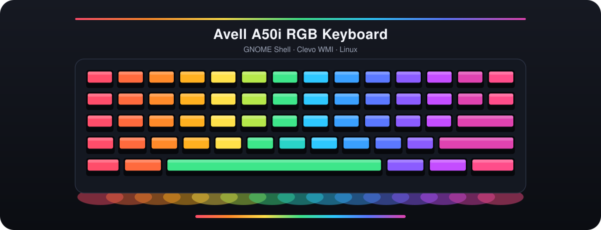
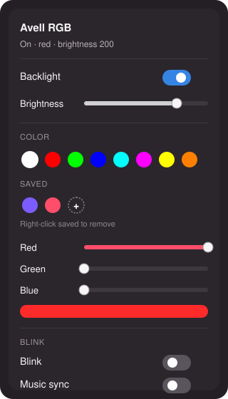

<div align="center">



<br>


<br>

Control solid color, brightness, blink, and music sync on the Avell A50i RGB keyboard from GNOME.

</div>

The A50i exposes **Clevo WMI** (`ABBC0F6D…`), not an ITE USB controller. This project installs a patched `tuxedo-drivers` module (Avell DMI allow-list) and a GNOME Shell extension that writes `/sys/class/leds/rgb:kbd_backlight*`.

## Requirements

- Debian or Ubuntu with GNOME Shell 48+
- `dkms`, `linux-headers-$(uname -r)`, `build-essential`, `git`, `mokutil`
- Secure Boot: one reboot to enroll a MOK key (the installer starts this)

## Quick start

```bash
# 1) Kernel driver (needs sudo). Creates/signs modules and enrolls a MOK key.
sudo ./scripts/install-driver.sh

# 2) Reboot. At the blue MOK Manager screen:
#    Enroll MOK → Continue → Yes → password: rgbavell → Reboot
#    (password is also in driver/mok/mok-password.txt)

# 3) After reboot + MOK enroll, load modules and turn the keyboard red:
./scripts/after-reboot.sh

# 4) Install / enable the GNOME extension (then log out/in on Wayland)
./scripts/install-extension.sh
# Top bar → keyboard icon → color / brightness / on-off
```

## Extension

<table>
<tr>
<td width="340" valign="top">

</td>
<td valign="top">
The keyboard icon in the top bar opens this menu.
<ul>
<li>On/off toggle</li>
<li>Brightness slider</li>
<li>Color presets and R/G/B sliders</li>
<li>Save and remove custom colors (click <code>+</code>, right-click to remove)</li>
<li>Blink with adjustable rate and fade</li>
<li>Smooth color transitions between presets</li>
<li>Music sync: aubio tempo beats and a fixed palette (PipeWire/Pulse via <code>parec</code>; needs <code>python3-aubio</code>)</li>
<li>Restores the last color and brightness on login (GSettings)</li>
</ul>
</td>
</tr>
</table>

## Manual sysfs

```bash
echo '0 255 0' | sudo tee /sys/class/leds/rgb:kbd_backlight/multi_intensity
echo 200 | sudo tee /sys/class/leds/rgb:kbd_backlight/brightness
echo 0 | sudo tee /sys/class/leds/rgb:kbd_backlight/brightness   # off
```

With the udev rule installed, `sudo` is not required for those writes.

## Troubleshooting

| Symptom | What to check |
|---|---|
| `No rgb:kbd_backlight` | `lsmod \| grep -E 'tuxedo\|clevo'`; `dmesg \| grep -Ei 'tuxedo\|clevo'` |
| `Key was rejected by service` | Secure Boot MOK not enrolled. Reboot and finish MOK Manager |
| Extension says permission error | Re-run the driver install (udev rule), or `sudo chmod 0666 /sys/class/leds/rgb:kbd_backlight/*` |
| Color does not change | Driver loaded but the EC ignored the command. Open an issue with `dmesg` and `dmidecode -t system` |

## Layout

| Path | Role |
|---|---|
| `extension/rgb-keyboard@avell/` | GNOME Shell extension |
| `driver/patches/` | Avell DMI patch for tuxedo-drivers |
| `driver/udev/` | Non-root LED write permissions |
| `scripts/install-driver.sh` | Build, sign, and install modules |
| `scripts/after-reboot.sh` | Load modules and apply a test color |
| `scripts/install-extension.sh` | Install the extension for the current user |
| `scripts/test-leds.sh` | Smoke-test sysfs |
| `docs/` | README artwork |

## Out of scope (v1)

Per-zone colors, per-key RGB, and fan/thermal control.
